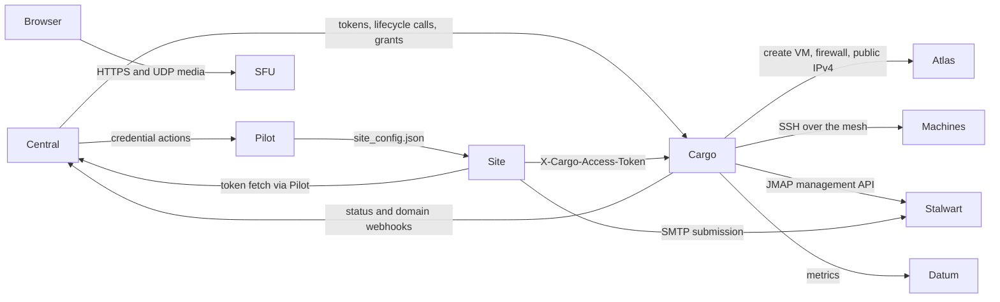
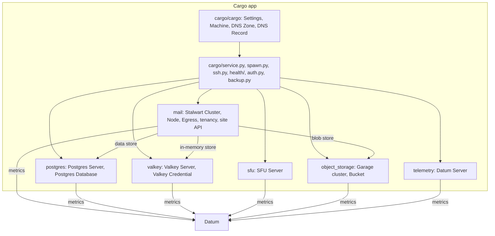
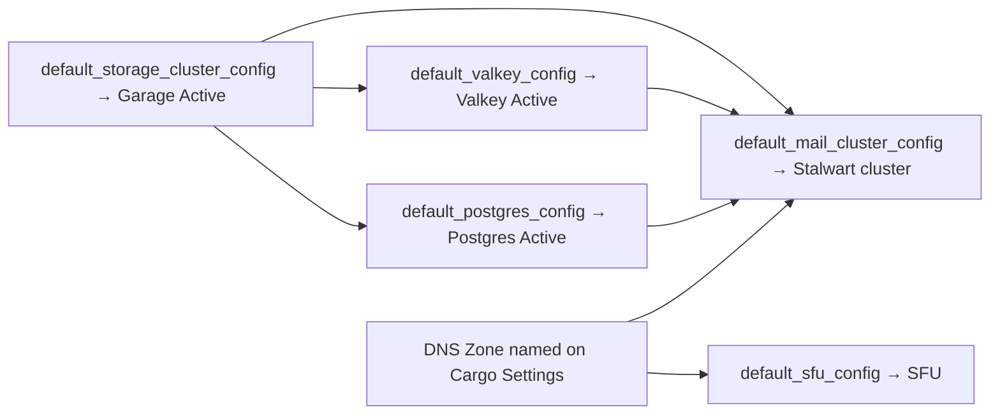
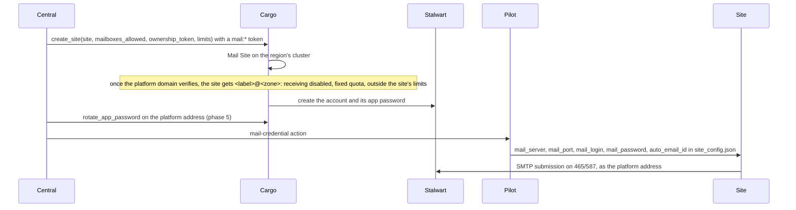
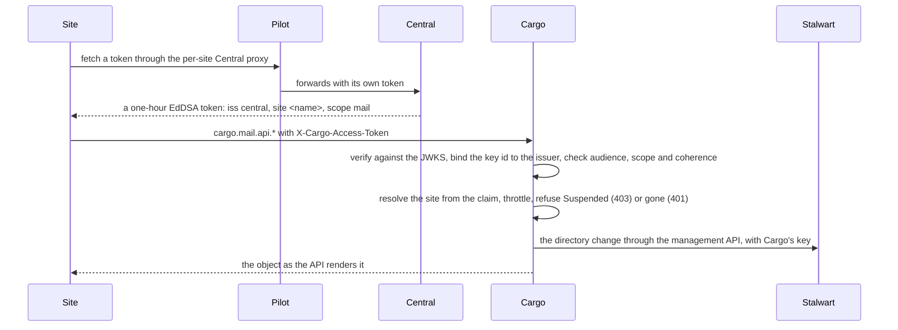
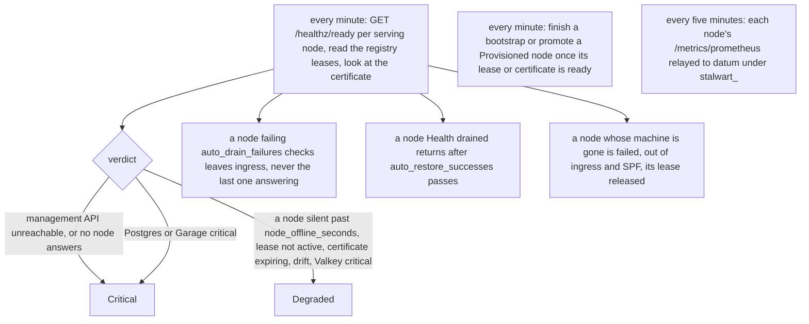

# Architecture: Cargo with mail and the SFU

How a region's mail cluster and SFU come to exist, how a site reaches them, and what talks to what. The records and runbooks are in [mail.md](mail.md), [postgres.md](postgres.md), [valkey.md](valkey.md) and [sfu.md](sfu.md); the service pattern they share is [service.md](service.md); the plan this grew from is [suite-cloud-migration.md](suite-cloud-migration.md).

## The planes

| Plane | Runs | Role here |
|---|---|---|
| Central | Globally, one | Knows teams, sites and regions. Mints every token Cargo accepts, keeps the domain registry, pushes credentials to sites through Pilot, receives Cargo's status and domain reports. |
| Atlas | Per region | Builds and destroys VMs on request, gives them a mesh address (`fdaa::/16`) and, when asked, a public IPv4 and a firewall. |
| Cargo | Per region, one Frappe site | Runs the region's shared services: object storage (Garage), telemetry (datum), Postgres, Valkey, mail (Stalwart), the SFU. Owns the tenancy of mail. |
| Pilot | Per tenant VM | Manages the benches and sites on that VM; carries Central's actions to a site, such as writing a credential into `site_config.json`, and proxies a site's token requests to Central. |
| Proxy | Per region | Fronts HTTP for `*.<wildcard domain>`. Mail and the SFU are reached directly, not through it: SMTP, IMAP and WebRTC are not HTTP. |
| Datum | Per region | Metrics and logs; Cargo relays each service's Prometheus series to it. |



## What Cargo is made of



Every service is a doctype in the same shape: a `status` for the build (Draft or Pending, Setting Up, Active, Failed), a `health` for how it is doing now, a Machine or machines rented from Atlas, a `@flow` of `@task`s that installs software over SSH, a webhook that tells Central `Available` or `Not Available`, and a spawner that builds it unattended from a key in site config. The single-machine ones (datum, Postgres, Valkey, SFU) are Frappe Singles; the clusters (Garage, Stalwart) are named records with nodes.

## Bringing a region up

The spawners run every minute and each waits for what it depends on, so a region assembles itself in order from site config alone.



`ensure_mail` rents nothing until Garage, Postgres and Valkey are Active, Postgres allows the nodes' connection pools, and an enabled DNS Zone is named. Then it makes the cluster's three store records in-process (a Postgres Database `stalwart`, a Valkey Credential `stalwart`, a Bucket `mail`), inserts the Stalwart Cluster on them, and rents the first node. The rest are rented one a run once the cluster serves. A machine that never came up is reported on the cluster and stops the run; a failed node is provisioned again up to three times. A cluster added by hand is never joined.

## A mail node, from machine to serving

```mermaid
sequenceDiagram
    participant Cargo
    participant Atlas
    participant Node as Node machine
    participant Stalwart as Stalwart on the node
    participant Central
    Cargo->>Atlas: reserve a public IPv4, then create VM (role mail, that allocation, firewall: 25/465/587/143/993/110/995/443/4190 + mesh)
    Atlas-->>Cargo: Pending → Running, mesh address, public IPv4
    Note over Cargo: sync_pending_machines copies the public IPv4 onto the node and publishes n1.<zone> A; provisioning starts
    Cargo->>Node: install.sh over SSH (binaries behind a symlink, Unbound with DNSSEC, the systemd unit)
    Cargo->>Node: bootstrap.sh (first node of a Pending cluster) or configure.sh (a node joining an Active one)
    Node->>Stalwart: bootstrap mode: data store; recovery mode: defaults, then the cluster plan; normal start
    Note over Cargo: every secret in the plan is handed to the SSH masker; nothing secret is a task argument
    Cargo->>Stalwart: finish_bootstrap: mint the management key, pick the default certificate, read the node's lease
    Cargo->>Cargo: cluster Active (a save, so the webhook fires); adopt the zone as the platform domain
    Cargo->>Central: service "mail" Available, with the public HTTPS base URL
    Note over Cargo: the node enters the ingress record mx.<zone> and SPF; a per-minute poll finishes what was not ready
```

The cluster plan is rendered from Cargo's records, not copied into them: the data store from the Postgres Database, the blob store from the Bucket and its one credential, the in-memory store from the Valkey Credential, so a rotated credential reaches the next plan by itself. The data store is baked into the node's `config.json`; the other two are settings the cluster plan re-pushes. A plan marker on the node records which plan it holds, so a re-run skips what is already applied.

## Names, addresses, zone

One cluster per region, in the region's mail zone `mail.<wildcard domain>`, which is a DNS Zone on Cargo Settings with a provider credential scoped to it. The zone apex is the cluster's default domain and the platform domain; `mx.<zone>` is the cluster hostname and the ingress round-robin of serving nodes; `n1.<zone>`, `n2.<zone>` are nodes; `g1.<zone>` gateways; `p1.out.<zone>` sending pools; `sfu.<zone>` the SFU. SPF at the apex includes `spf.<zone>`, which lists every serving node's and pool's address. Cargo writes all of these through the zone's provider; a Mail Domain's own records on a customer domain are the customer's to publish, and Cargo verifies them.

Two addresses per machine: the mesh address, which Cargo reaches for SSH and the management API, and the public IPv4, which is what DNS, SPF and reverse DNS carry. A running mail machine without a public address is a fault.

## A site's mail



Every site sends; only a site with `mailboxes_allowed` receives, and only on a domain this region holds mailboxes for. Suspending a site locks every enabled account onto a cluster role that keeps receiving and loses everything else, and a status check holds off the API; resuming unlocks exactly what suspension locked. Archiving locks the accounts, disables the domains with a 90-day hold, and rotates the ownership token; with `delete_data` the directory is purged afterwards, one object a transaction. A site cannot resize, delete or re-flag its platform address, and cannot make addresses of its own on the platform domain or take mail at a domain nobody owns.

### A site calling the directory API



Who signed a token limits what it may say: only Central names a site or hands out a mail, grant or SFU scope; Atlas may vouch for `bucket:*` alone; a site's token never carries a wide scope. Objects of another site, and Central's and the platform's, answer not-found.

### A customer domain

```mermaid
sequenceDiagram
    participant Site
    participant Central
    participant Cargo
    participant DNS as Public DNS
    participant Stalwart
    Site->>Central: ask for a grant (mail_domain_grant, phase 7)
    Central-->>Site: a ten-minute mail:domain token: site, domain, holds_mailboxes
    Site->>Cargo: create_domain(domain, grant)
    Cargo->>DNS: the team's ownership TXT at the domain must resolve
    Cargo->>Stalwart: create the domain with DKIM keys under cargo-<region>-rsa and -ed25519
    Cargo-->>Site: the records to publish: SPF include, DKIM, DMARC, MX, TLS-RPT
    loop hourly and daily
        Cargo->>DNS: verify the records; the domain is live once SPF, DMARC, one DKIM and the ownership record resolve
    end
    Cargo->>Central: kind "domain" webhooks: registered, changed, purged
```

A domain may be added in several regions; the one holding the mailboxes keeps the MX, the others relay. Ownership is re-verified daily and lapses after seven misses. A disabled domain of an archived site may be claimed by another site after its own proof, and is purged after the hold.

## Keeping the cluster well



Upgrades roll: on the cluster, Upgrade Nodes drains one Active node, installs the cluster's version beside the old one, restarts it, waits for its lease, puts it back into ingress and soaks for `soak_minutes` with the cluster Healthy before the next, the bootstrap node last. A failure stops the flow with that node out of ingress; rollback flips the symlink back. A node whose machine died is replaced by releasing the machine and requesting another on the same record; its name and number stay.

## Where state lives

| Holder | What | Protected by |
|---|---|---|
| Cargo's own database | Who owns which domain, every site's limits and tokens, the directory mirror with its Stalwart ids, every service credential | A daily dump to a `cargo-backups` bucket on the region's Garage; the encryption key stays out of the region |
| Postgres | Stalwart's settings, directory, message metadata, DKIM keys | Nightly `pg_dump` of every database to `postgres-backups`, thirty days kept, `restore.sh` |
| Garage | Message bodies and the dumps above | Garage's own replication |
| Valkey | Coordinator pub/sub, rate limits, greylist | Nothing: transient, restarts empty |
| A node's `/etc/stalwart` | `config.json` with the data store connection, the plan marker | Rebuilt by `configure.sh` |

## The SFU

```mermaid
sequenceDiagram
    participant Cargo
    participant Atlas
    participant Machine
    participant Central
    participant Pilot
    participant Browser
    Cargo->>Atlas: reserve a public IPv4, then create VM (role sfu, that allocation, firewall: 80, 443, one UDP port per worker from 40000)
    Atlas-->>Cargo: Running with a public IPv4
    Cargo->>Cargo: publish sfu.<zone> A → the public IPv4
    Cargo->>Machine: install.sh over SSH: Docker, the Suite project's deployment from a pinned frappe/suite ref, its .env, deploy.sh setup
    Machine->>Machine: nginx and certbot take a certificate for sfu.<zone>; the SFU answers /health
    Cargo->>Central: service "sfu" Available, with https://sfu.<zone>
    Central->>Cargo: get_credential with an sfu:* token
    Cargo-->>Central: sfu_server_url, sfu_secret
    Central->>Pilot: configure the site (phase 5, as the mail credential)
    Pilot->>Site: sfu_server_url and sfu_secret in site_config.json
    Browser->>Machine: HTTPS signaling with a room token the site signed; UDP media to the announced IP
```

The SFU keeps no state Cargo cares about and runs the Suite project's own Docker deployment unchanged; Cargo contributes the machine, the name, the environment, the health probe and the secret. Health asks `https://sfu.<zone>/health` every minute; anything but a 2xx is Critical.

## What the Internet may reach

| Machine | From anywhere | From the mesh only |
|---|---|---|
| Mail node | TCP 25, 465, 587, 143, 993, 110, 995, 443, 4190; ICMP | Everything else, SSH included; the recovery port 8080 on loopback alone |
| Egress gateway | TCP 443; relay ports from the cluster's nodes' addresses only | Everything else |
| SFU | TCP 80, 443; UDP one port per worker from the media port | Everything else |
| Postgres, Valkey, Garage nodes, datum | Nothing | Everything; Garage and datum are fronted by the Proxy for HTTP |

A gateway's firewall is fixed when its machine is built; a node or pool added later is blocked until the gateway's machine is rebuilt, which waits for Atlas to change a running machine's rules.

## Checking a region

`tools/stalwart-compat/run.sh` runs the rendered install and bootstrap scripts against the pinned Stalwart in CI. `tools/e2e/mail.sh` takes a single-node cluster through the real flows on fake_atlas. `tools/mail-smoke/check.sh <cluster> --phase 3|6|7` is what a real region must pass: Cargo's own checks, a public resolver's answers for every record, and the certificate presented on every port.
